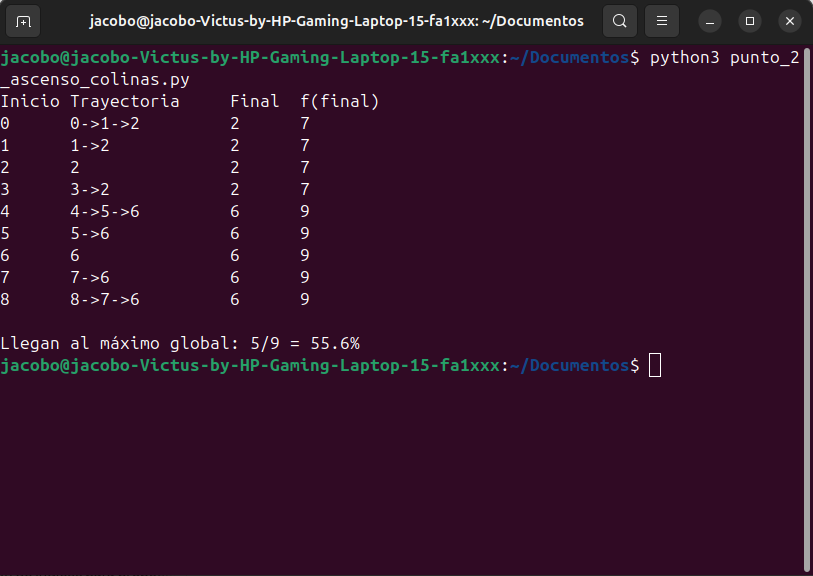
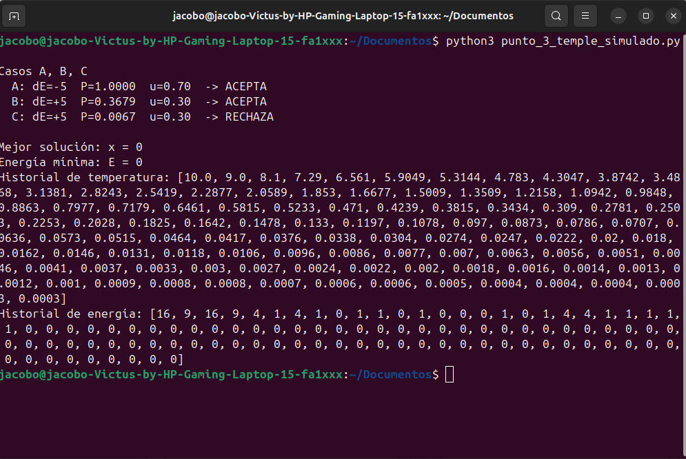

# Parcial 2 

Puntos 2 y 3: ascenso de colinas y temple simulado.

## Contenido

```
.
├── punto_2_ascenso_colinas.py    # Punto 2
├── punto_3_temple_simulado.py    # Punto 3
├── ejecucion_punto_2.png         # Captura de ejecución, punto 2
├── ejecucion_punto_3.png         # Captura de ejecución, punto 3
└── README.md
```

## Requisitos

- Python 3.8+

## Ejecución

```bash
python3 punto_2_ascenso_colinas.py
python3 punto_3_temple_simulado.py
```

## Punto 2 – Ascenso de colinas

Maximiza `f = [1, 4, 7, 5, 3, 6, 9, 8, 5]` sobre `x = 0..8`. Vecinos `x-1` y `x+1`; solo se mueve con mejora estricta.

```python
def ascenso_colinas(valores, inicio):
    """Devuelve el estado final y la trayectoria."""
```

- Máximos locales: `x=2` (f=7) y `x=6` (f=9).
- Máximo global: `x=6`.
- Cuencas de atracción: `{0,1,2,3} → 2` y `{4,5,6,7,8} → 6`.
- Llegan al global 5 de 9 estados iniciales (55,6 %).



## Punto 3 – Temple simulado

Minimiza `E(x) = x²` sobre `x ∈ {-5, ..., 5}`.

| Parámetro | Valor |
|---|---|
| Estado inicial | `x0 = 5` |
| Temperatura inicial | `T0 = 10` |
| Enfriamiento | `T(k+1) = 0.90 * T(k)` |
| Candidato | `x-1` o `x+1` al azar (vecinos válidos) |
| Iteraciones | 100 |
| Semilla | 42 |

| Caso | Transición | T | u | ΔE | P | Decisión |
|---|---|---|---|---|---|---|
| A | 3 → 2 | 5 | 0,70 | −5 | 1 | Acepta |
| B | 2 → 3 | 5 | 0,30 | +5 | 0,3679 | Acepta |
| C | 2 → 3 | 1 | 0,30 | +5 | 0,0067 | Rechaza |

Resultado (semilla 42): mejor solución `x = 0`, energía mínima `E = 0`.


